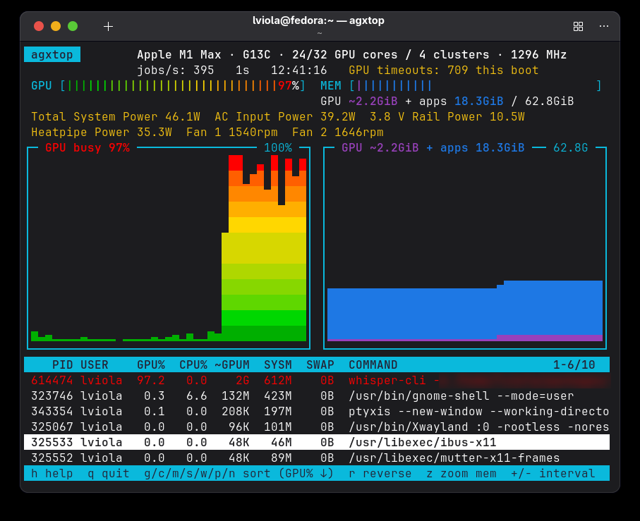

# agxtop

An nvtop-style GPU monitor for [Asahi Linux](https://asahilinux.org) on Apple Silicon.



The Asahi GPU driver exposes no performance counters yet, so tools like nvtop
show nothing there. agxtop builds the picture from what the kernel does expose:

| Shows | Source |
|---|---|
| GPU busy % and graph | `gpu_scheduler` tracepoints via `perf_event_open` (time from job run to job done) |
| Per-process GPU % | `drm_sched_job_queue` is logged in the submitting process |
| GPU memory per process | `drm-*` keys in fdinfo, else size of mapped GPU buffers (marked `~`) |
| Chip, GPU cores, clusters, max clock | `DRM_IOCTL_ASAHI_GET_PARAMS`, falling back to the driver's boot log |
| GPU timeouts | kernel log |
| Power, fans | `macsmc_hwmon` sensors (whole machine) |

"Busy" means the GPU had at least one job queued or running, so it can read
higher than real shader load.

## Install

On Fedora Asahi Remix, from [Copr](https://copr.fedorainfracloud.org/coprs/lviola/agxtop/):

```
sudo dnf copr enable lviola/agxtop
sudo dnf install agxtop
```

The package sets the capabilities, so `agxtop` runs without sudo.

### From source

Needs a Rust toolchain (`sudo dnf install cargo`).

```
make install
```

This builds the binary, installs it to `/usr/local/bin/agxtop` and grants it
`cap_perfmon,cap_dac_read_search` so it runs without sudo. Both capabilities
are dropped right after startup. Run `make install` again after every rebuild:
replacing the file clears the capabilities.

Without the capabilities, `sudo agxtop` also works (it then falls back to
reading tracefs directly when perf isn't available).

## Keys

`↑ ↓ PgUp PgDn Home End` select · `g m p n` sort by GPU% / memory / PID / name
· `r` reverse · `z` zoom memory graph · `Tab` switch graph (narrow terminals)
· `+ -` refresh interval · `h ? F1` help · `q` quit

## Limitations

- No per-core GPU load: the firmware schedules work across cores and never
  tells the kernel which cores ran a job.
- Without root, only your own processes are listed.
- Tested on an M1 Max (Fedora Asahi Remix). Chip names are known for M1/M2.

## Legacy

`legacy/agxtop.py` is the original single-file Python/curses version (tracefs
only, needs sudo). It is kept for reference.
